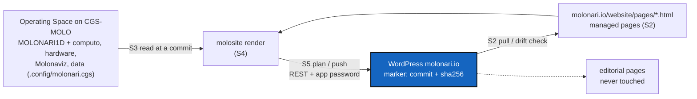

# WordpressSync — molonari.io follows MOLONARI1D `CGS-MOLO`, through a pixi task of MOLONARI-gate

*Created: 2026-11-11*

*Repository: `flipoyo/MOLONARI-gate` (mounted at `molonari.io/`), branch `CGS-MOLO`*

> **Owner direction — 2026-11-11:** *"MOLONARI1D is completely rebuilt based on
> OperatingSpaces operated by ComplexGitSync under pixi environment connector.
> molonari.io wordpress web site was developed last year. Could you propose to
> update it with the new structure of MOLONARI1D and develop a python project
> that would help keep the wordpress sync with the CGS-MOLO branch of
> MOLONARI1D. Don't do anything yet but propose a DevPlanTicket for
> MOLONARI-GATE."*

## Abstract — read this first

**The one-line version.** The site's pages move into git. MOLONARI-gate gets a
small Python package, `molosite`, run by pixi (`pixi run site …`). It renders
the pages that describe the project from the `CGS-MOLO` checkouts of the
Operating Space and pushes them to WordPress through the REST API. Pages written
by hand stay in WordPress and are never touched. Every pushed page carries a
marker with the source commit and the hash of what was pushed, so a hand edit
made in WordPress is detected, never overwritten.

**Three kinds of page.**

| Mode | Source of truth | Who writes it | Examples |
|---|---|---|---|
| `generated` | MOLONARI1D `CGS-MOLO` and its Operating Space (`.config/*.cgs`, `pixi.toml`, READMEs, `Figures/`) | `molosite` renders it | Developing MOLONARI, Operating Space (new), Get started (new) |
| `managed` | `molonari.io/website/pages/<slug>.html` in MOLONARI-gate | people, in git (pulled once from WordPress) | Molonari-1D, Lab testing, Home |
| `editorial` | WordPress | people, in the WordPress editor | Gallery, Results, askdb (shortcode `[sqlite_molonaviz]`) |

**Where we start (verified 2026-11-11).**

- `https://molonari.io` answers 200. The REST API is open (`/wp-json/`, namespace
  `wp/v2`) and **application passwords** are enabled.
- 7 pages, none of them in git: `molonari` (id 6, front page, edited
  2026-04-01), `molonari-1d` (32), `gallery` (112), `results` (178), `askdb` (200),
  `lab-testing` (216), `development` (227). All but the front page were last
  edited between 10 and 15 November 2025.
- Nothing on the site mentions the new structure: no Operating Space, no pixi,
  no `molo load`, no MOLONARI-computo / -hardware / -API / -gate. The only code
  link is `github.com/flipoyo/MOLONARI1D` (front page). `development` is a
  304-character stub.
- `website/wordpress_sqlite_plugin.md` and the live `askdb` page still assume the
  old layout: `git clone MOLONARI1D`, `python -m Molonaviz.src.receiver.main`,
  database at `/root/MOLONARI1D/Molonaviz/TestDatabase/Molonari.sqlite`.
- MOLONARI-gate is 0.1.1 and pixi only runs `bump-version` / `check-version`; it
  has no Python code of its own.
- The HTTPS certificate is back, but **`certbot renew --dry-run` still fails for
  `www`** (INCIDENT_20261111). Application passwords need HTTPS.

**The route** (§ 2): S1 `molosite` skeleton under pixi → S2 pull the existing
pages into git, losslessly → S3 sources from the `CGS-MOLO` Operating Space →
S4 render generated pages → S5 `plan` / `push` with drift detection → S6 the new
site map, pushed → S7 (optional) the VPS checkout becomes an Operating Space.



## 0. Related tickets and documents

| Item | State on 2026-11-11 | For this ticket |
|---|---|---|
| INCIDENT_20261111 (HTTPS) | **Partly resolved.** 200 over HTTPS; `certbot renew --dry-run` fails for `www` (ACME 404); Dovecot down. | **Prerequisite** for S5: a `push` stops when HTTPS fails, and the next expiry would break the sync. Fix renewal first, or in parallel. |
| `website/wordpress_*.md` | Describe last year's manual workflow. | S6 rewrites `wordpress_building.md` around `molosite`; S7 updates `wordpress_sqlite_plugin.md`. |
| MOLONARI1D `README.md` § Repository Structure | **Stale**: lists `hardware/sensors`, `relay`, `shared`, and `dataAnalysis/`, none of which exist; "Recent Improvements (December 2024)". | **Not used as a source** (B4). Generated pages take the structure from `.config/molonari.cgs` and each repository's `pixi.toml`. A README fix is a follow-up in MOLONARI1D. |

## 1. What blocks it today

| # | Blocker | Where |
|---|---|---|
| B1 | **The content lives only in the WordPress database.** No history and no review, and nothing to compare with git. | VPS, MySQL `wordpress_db` |
| B2 | **No code in MOLONARI-gate**, and its pixi manifest has no dependencies. | `molonari.io/pixi.toml` |
| B3 | **No identity to write with.** Only the admin account exists; writing to the REST API needs a dedicated account with an application password. | WordPress users |
| B4 | **The root README describes a structure that no longer exists.** Rendering from it would publish the old layout again. | MOLONARI1D `README.md` |
| B5 | **Pages are Gutenberg block markup**, not Markdown. If a push wraps everything in one `wp:html` block, the page can no longer be edited in the editor. | WordPress page format |
| B6 | **HTTPS renewal is not reliable** (see § 0). | VPS, certbot |
| B7 | **No CI**: the GitHub workflows were removed (no credits). The sync cannot hang off a GitHub push event. | MOLONARI1D `b847f78` |
| B8 | **`askdb` reads a database from a clone that follows the old layout** (`/root/MOLONARI1D/Molonaviz/…`). | VPS, plugin `sqlite-molonaviz` |

## 2. The route

### S1 — `molosite` skeleton under pixi (1 h)

- Package `molonari.io/src/molosite/`, declared in `molonari.io/pyproject.toml`
  and installed editable by pixi. Dependencies are all on conda-forge:
  `requests`, `markdown-it-py`, `jinja2`, `pytest`, `responses` (test only).
  Python follows the gate: `>=3.11,<3.14`.
- Modules, one job each:

  | Module | Job |
  |---|---|
  | `config.py` | reads `website/site.toml`: base URL, page map (slug → id, mode, template, parent) |
  | `source.py` | `BranchSource`: a file of a repository of the Operating Space at a commit (S3) |
  | `render.py` | Markdown → Gutenberg core blocks; Jinja templates for generated pages (S4) |
  | `wp.py` | `WordPress`: REST client (pages in `context=edit`, media, auth) |
  | `marker.py` | the sync marker: write, read, verify (S5) |
  | `cli.py` | `pull`, `plan`, `push`, `check` |

- Pixi tasks in `molonari.io/pixi.toml`:

  ```toml
  site       = "molosite"                 # pixi run site plan | push | pull | check
  site-plan  = "molosite plan"
  site-check = "molosite check"           # offline: config, templates, sources resolvable
  test       = "python -m pytest"
  test-all   = { depends-on = ["check-version", "test", "site-check"] }
  ```

- Credentials come from the environment only: `MOLO_WP_USER` and
  `MOLO_WP_APP_PASSWORD`. They are never read from a file in the tree and never
  printed; `.env*` goes into `.gitignore`.
- Test: `pixi install && pixi run test-all` on a fresh clone of MOLONARI-gate.

### S2 — Pull the existing pages into git, losslessly (1 h)

- `pixi run site pull` reads every page with `context=edit` and writes the
  **raw block markup** to `website/pages/<slug>.html`, unchanged, with
  `website/site.toml` entries (id, slug, title, parent, menu order, template).
  It does not convert to Markdown, so nothing is lost (B5, D2).
- Media used by those pages are listed in `website/media.toml` (id, URL,
  sha256). They are not downloaded into git.
- After the first pull, the owner sets each page's mode in `site.toml`.
  Proposal: `molonari`, `molonari-1d` and `lab-testing` are `managed`;
  `gallery`, `results` and `askdb` are `editorial`; `development` is replaced
  by a generated page (S6).
- This is the backup step too: commit S2 before any push.
- Test: `pull`, then `plan` against the same site, shows **no change** for
  every page.

### S3 — Sources from the `CGS-MOLO` Operating Space (1 h 30)

- `molosite` runs **inside the Operating Space**, where MOLONARI-gate is
  mounted at `molonari.io/`. `CGSHOME` is the nearest directory above holding
  `.cgitsync/` (the cgitsync rule). The other repositories are its siblings.
- `BranchSource(repo_path, ref="CGS-MOLO")` reads files with
  `git show <ref>:<path>`, not from the working tree, so local edits that are
  not committed never reach the site. It records the commit sha of each
  repository it reads.
- It refuses when a repository is not on `CGS-MOLO` or is behind
  `origin/CGS-MOLO`, and says `pixi run molo update .config/molonari.cgs`.
  `--allow-behind` overrides it for a preview.
- Without an Operating Space (a plain clone of MOLONARI-gate), `--github` reads
  the same files from `raw.githubusercontent.com` at the `CGS-MOLO` head. All
  six repositories are public, so this needs no token.
- What it reads (and never the stale README tree, B4):

  | Fact | Source |
  |---|---|
  | repositories, mount paths, branches | MOLONARI1D `.config/molonari.cgs`, `molonari-light.cgs`, `simu-direct.cgs`, `install-orx.cgs` |
  | versions | `[workspace] version` of each repository's `pixi.toml` |
  | how to recompose | MOLONARI1D `README.md` § "Recompose the Operating Space" and § "Administration with pixi" (sections chosen by heading, D4) |
  | what each repository is | first paragraph of `computo/README.md`, `hardware/README.md`, `data/README.md`; Molonaviz has no README, so its line is written in `site.toml` |
  | figures | MOLONARI1D `Figures/*.png` |

- Tests: a fake Operating Space (three bare repositories plus `.cgitsync/`, made
  in `tmp_path`) gives the expected shas; a repository on the wrong branch is
  refused; an uncommitted change is not read.

### S4 — Render the generated pages (2 h)

- Templates in `website/templates/<slug>.md.j2` (Markdown + Jinja). The context
  is the facts of S3.
- `render.py` turns Markdown into **core blocks**: `wp:heading`,
  `wp:paragraph`, `wp:list`, `wp:code`, `wp:table`, `wp:image`. Any page can
  still be opened and edited in the editor. LaTeX `\( \)` passes through for
  the MathJax-LaTeX plugin. The anchor ids used by "Page scroll to id" are kept.
- Images: `Figures/*.png` are uploaded once through `/wp/v2/media`, named
  `<stem>-<sha256[:8]>.png`, so the same file is never uploaded twice and a
  changed figure gets a new name.
- Each generated page ends with a footer: *"Generated from MOLONARI1D
  `CGS-MOLO` @ `<sha>` on `<date>`"*, with links to the repositories.
- Tests: golden files: the fixed fake Operating Space renders byte for byte to
  `tests/golden/<slug>.html`; every block opens and closes (a block parser in
  the test); rendering twice gives the same output.

### S5 — `plan` and `push`, with drift detection (2 h)

- **The marker.** Each pushed page ends with
  `<!-- molosite {"src":"MOLONARI1D@<sha>","sha256":"<hash of the content above>","v":"<molosite version>"} -->`.
  HTML comments are kept by WordPress and invisible to readers, so no plugin
  and no custom meta are needed.
- **`plan`** (the default; it writes nothing): for each `generated` and
  `managed` page it prints `unchanged`, `update` (with a unified diff), `create`,
  or **`drift`**. `drift` means the live content no longer hashes to its marker,
  because someone edited it in WordPress.
- **`push`** applies the plan. It:
  1. refuses a page in `drift` and says `pixi run site pull <slug>`, which takes
     the hand edit into git, to be reviewed and committed. `--adopt <slug>`
     overwrites, only when asked by name;
  2. never touches an `editorial` page, nor a page missing from `site.toml`;
  3. before each update, saves the live raw content to
     `molonari.io/.dev/.backup/<date>/<slug>.html`. The directory is not
     tracked; WordPress revisions are a second copy;
  4. refuses on a dirty MOLONARI-gate checkout, so what is pushed is always a
     commit;
  5. stops at the first HTTP error, prints what was pushed, and returns
     non-zero.
- **`check`** is the offline gate: `site.toml` is valid, every template renders,
  every source resolves, and no page appears twice.
- Tests (`responses`, no network): plan on an identical site is empty; a hand
  edit gives `drift` and `push` refuses it; `--adopt` overwrites; an editorial
  page receives no request; a 401 stops with no partial write after it.

### S6 — The new site map, pushed (owner + 2 h)

| Page | Slug | Mode | Change |
|---|---|---|---|
| Molonari (front) | `molonari` | managed | Code link points to the Operating Space page; one "Get started" line: `pixi run molo load .config/molonari.cgs`. |
| Molonari-1D | `molonari-1d` | managed | Science text kept. "Computing" and "Hardware" link to MOLONARI-computo and MOLONARI-hardware. |
| **Operating Space** | `operating-space` (new) | generated | One row per repository of `molonari.cgs`: name, mount path, branch, version, one-line role, GitHub link. Lists the four `.config/*.cgs` variants. |
| **Get started** | `get-started` (new) | generated | Install pixi, then `molo load / update / status`, `--https`, `test-all`. |
| Developing MOLONARI | `development` | generated | Replaces the stub: SemVer and `bump-version`, `CGS-MOLO` as the development branch, commit subject `MOLONARI1D-<version> …`, link to lab-testing. |
| Lab testing | `lab-testing` | managed | Unchanged. |
| Gallery, Results, askdb | — | editorial | Unchanged (askdb: see S7). |

- Menu: Home · MOLONARI-1D · Get started · Operating Space · Development ·
  Results · Gallery. The menu belongs to the Site editor (navigation block), so it
  is set by hand once (D5).
- Order: `plan` → owner reviews the diff → `push` → check in a browser →
  commit `website/` and tag MOLONARI-gate **0.2.0** (`pixi run bump-version minor`).
- Rewrite `website/wordpress_building.md`: generated and managed pages are
  edited in git and pushed with `pixi run site push`; only editorial pages are
  edited in WordPress.

### S7 — Optional: the VPS checkout becomes an Operating Space (owner, 1 h)

- On the VPS: `pixi run molo load .config/molonari-light.cgs`, then point
  `sqlite-molonaviz.php` to the database in the Molonaviz mount of that space
  (B8). Update `wordpress_sqlite_plugin.md`.
- The same space can then run `pixi run site push` from a root cron
  (`molo update` first). That is the unattended trigger that B7 rules out on
  GitHub (D3).

## 3. Decisions for the owner

| # | Question | Proposal |
|---|---|---|
| D1 | Package name and place? | `molosite`, in MOLONARI-gate (`src/molosite`), run by MOLONARI-gate's pixi. It is part of "the website, server and deployment part", not of MOLONARI1D. |
| D2 | Format of managed pages in git? | **Raw block markup (`.html`)**, which is lossless. Markdown only for generated pages. Converting last year's pages to Markdown would lose layout (groups, galleries, columns). |
| D3 | What triggers a push? | **Manual first** (`pixi run site plan`, then `push`) from the owner's Operating Space. A VPS cron (S7) once a few manual pushes have been clean. No GitHub Actions (B7). |
| D4 | Which README sections feed the site? | Chosen by heading in `site.toml`, so renaming a heading breaks `check`, not the site. The structure always comes from `.config/*.cgs`, never from the README tree. |
| D5 | Menu and Site editor (header, footer)? | Left to the editor. They are template parts, not pages; syncing them is a later ticket if needed. |
| D6 | WordPress account? | A dedicated user `molosite` with the **Editor** role (not Administrator) and one application password, revocable on its own. Upload rights come with Editor. |
| D7 | Where do the credentials live? | Environment variables for now. When `@cgs` gates the MOLONARI Operating Space, the application password can become a secret of that gate: a short ticket. |
| D8 | Language? | English, as today. A French version is out of scope. |

## 4. Refusals

- No write to an `editorial` page, nor to a page missing from `site.toml`.
- No overwrite of a page in `drift` unless `--adopt <slug>` names it.
- No push from a dirty checkout, and no source read from a working tree, only
  from `CGS-MOLO` commits.
- No credential in git, in a log, in `plan` output, or in a URL.
- No WordPress plugin, theme or PHP change from `molosite`: content and media
  only.
- No Administrator credentials for the sync.
- No content from the stale README tree (B4).

## 5. Acceptance

- `pixi install && pixi run test-all` passes in a fresh clone of MOLONARI-gate,
  and in the Operating Space.
- `website/pages/` holds the 7 pages as pulled; right after the pull,
  `pixi run site plan` shows no change.
- After S6, `pixi run site plan` shows no change, and every generated page's
  footer names the MOLONARI1D `CGS-MOLO` sha it was rendered from.
- A one-line change committed on MOLONARI1D `CGS-MOLO` (for example a version
  bump) appears as an `update` in `plan` after `molo update`, and nowhere else.
- A hand edit in WordPress of a managed page gives `drift`; `push` refuses it,
  and `pull <slug>` brings it into git.
- `gallery`, `results` and `askdb` received no write request (checked in the
  WordPress revisions).
- `certbot renew --dry-run` passes for `molonari.io` and `www.molonari.io`
  (prerequisite B6).
- MOLONARI-gate tagged 0.2.0. On closing, stamp
  `YYYYMMDD_WordpressSync_DevPlanTicket.md` and move it to `.dev/.ticket/.archive/`.

## Estimate

About 10 h of development (S1–S5) and 3 h with the owner (S2 modes, S6 review
and push, S7 if wanted).
