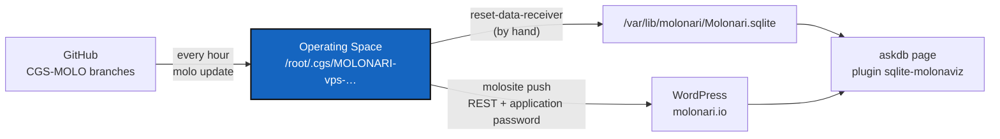

# The Operating Space on the molonari.io server

*Created: 2026-11-11. Server: `vps115892` (LWS, Debian 12), the host of `https://molonari.io`.*

## Abstract — read this first

**The one-line version.** The server holds its own MOLONARI Operating Space, loaded from `.config/molonari-vps.cgs`. Every hour, a root cron job updates it from the `CGS-MOLO` branches on GitHub and runs `molosite`, which pushes the pages generated from those branches to WordPress. The `askdb` page reads a database file at a fixed path, `/var/lib/molonari/Molonari.sqlite`, copied from the receiver repository.

**What this document is.** The record of everything done on the server on 2026-11-11 to get there, in the order it was done, with the exact commands, and the procedure to rebuild it on a new server. The website side (`molosite`, the page modes, the routine from a laptop) is in `website/wordpress_building.md`. Changing the `.cgs`, or the receiver and its database, is in [reset-data-receiver.md](reset-data-receiver.md).

**Who it is for.** Whoever administers the VPS: the project owner, and the students who take over the website.



## 0. What is on the server, and where

None of it is in git except the scripts in `molonari.io/server/vps/`, which are copied into place.

| What | Where | Mode, owner |
|---|---|---|
| pixi | `/root/.pixi/bin/pixi` (0.84.2) | root |
| The Operating Space | `/root/.cgs/MOLONARI-vps-20261111164052` (`CGSHOME`) | root, `755` |
| The settings of the two scripts | `/etc/molonari/vps.env`, from `server/vps/vps.env.example` | root, `644`, no secret |
| The credentials of `molosite` | `/root/.molosite.env` | root, `600` |
| The sync script | `/usr/local/sbin/molosite-sync`, from `server/vps/molosite-sync.sh` | root, `700` |
| The database script | `/usr/local/sbin/reset-data-receiver`, from `server/vps/reset-data-receiver.sh` | root, `700` |
| The schedule | root crontab: `17 * * * * /usr/local/sbin/molosite-sync >> /var/log/molosite-sync.log 2>&1` | |
| The log | `/var/log/molosite-sync.log`, rotated by `/etc/logrotate.d/molosite-sync` (weekly, 8 kept) | |
| The `askdb` database | `/var/lib/molonari/Molonari.sqlite` (and `.prev`, the one before) | root; folder `755`, file `644` |
| The `askdb` plugin | `/var/www/html/molonari.io/wordpress/wp-content/plugins/sqlite-molonaviz/sqlite-molonaviz.php` | `$db_path` is `/var/lib/molonari/Molonari.sqlite` |
| The login helper for PHP-FPM | `/var/www/html/molonari.io/wordpress/wp-content/mu-plugins/molosite-basic-auth.php` | owner of `plugins/` |
| The nginx site | `/etc/nginx/sites-available/molonari.io` (linked from `sites-enabled/`) | three changes, § 2 |
| Backups made on 2026-11-11 | `/root/molonari.io.nginx.bak-20261111` (before § 2.1), `/root/molonari.io.nginx.bak2-20261111` (before § 2.2), `/root/sqlite-molonaviz.php.bak-20261111`, `/root/backup/Molonari-2025.sqlite` | root |

The server also runs ISPConfig (two root cron lines run `/usr/local/ispconfig/server/…` every minute). They were not touched.

## 1. WordPress: the account that writes

In the browser, as an administrator, at `https://molonari.io/wp-admin`:

1. Users, Add New: user `molosite`, role **Editor**. It is never an Administrator: it can write pages and media, nothing else.
2. Users, `molosite`, Edit, *Application Passwords*: one password per machine, each revocable on its own.
   - `molosite`, for the owner's laptop (kept in the terminal session only);
   - `molosite-vps`, for the server (in `/root/.molosite.env`, § 6).

The password must be created **on the `molosite` profile itself**. On 2026-11-11 the first one was created on another profile, and the login failed with `rest_not_logged_in` until a diagnostic (§ 10) showed `app passwords: 0` for `molosite`.

## 2. nginx: three changes

The web server is nginx with PHP-FPM (`php8.1-fpm`); there is no Apache. All three changes are in `/etc/nginx/sites-available/molonari.io`. Edit that file, not the link in `sites-enabled/`, since `sed -i` on a link replaces it with a plain file. After each change: `nginx -t && systemctl reload nginx`. Reload only when `nginx -t` passes.

### 2.1 Pass the `Authorization` header to PHP

The REST login of `molosite` is HTTP Basic: without this line WordPress never sees it. In the `location ~ \.php$` block, after `include fastcgi_params;`:

```nginx
fastcgi_param HTTP_AUTHORIZATION $http_authorization;
```

Done with:

```bash
f=$(readlink -f /etc/nginx/sites-enabled/molonari.io)       # /etc/nginx/sites-available/molonari.io
cp -L /etc/nginx/sites-enabled/molonari.io /root/molonari.io.nginx.bak-20261111
sed -i '14a\        fastcgi_param HTTP_AUTHORIZATION $http_authorization;' "$f"   # line 14 was `include fastcgi_params;`
nginx -t && systemctl reload nginx
```

### 2.2 Serve `www.molonari.io`, so the certificate renews

`certbot renew --dry-run` failed for `www` with a 404 (B6 of the WordpressSync ticket, and INCIDENT_20261111). DNS was right: both names point to the server. The cause was nginx: `www` was in no `server_name`, and the port-80 block redirected only `$host = molonari.io` to HTTPS, so the Let's Encrypt challenge for `www` reached `return 404`. Two edits: `www` in both `server_name` lines, and a redirect for both names:

```bash
f=/etc/nginx/sites-available/molonari.io
cp $f /root/molonari.io.nginx.bak2-20261111
sed -i 's/server_name molonari\.io;/server_name molonari.io www.molonari.io;/' $f
sed -i 's/if (\$host = molonari\.io)/if ($host ~ ^(www\\.)?molonari\\.io$)/' $f
nginx -t && systemctl reload nginx
certbot renew --dry-run 2>&1 | tail -8      # Congratulations, all simulated renewals succeeded
```

The port-80 block now reads `if ($host ~ ^(www\.)?molonari\.io$) { return 301 https://$host$request_uri; }`. Checked: `http://molonari.io/` and `http://www.molonari.io/` answer 301 to HTTPS, and `https://www.molonari.io/` answers 301 to `https://molonari.io/`.

## 3. The login helper (must-use plugin)

With nginx passing the header (§ 2.1), PHP-FPM still does not fill `PHP_AUTH_USER` and `PHP_AUTH_PW`, which is where WordPress application passwords read the login. A must-use plugin (loaded by WordPress on every request, with no activation) copies them from the header. It touches nothing else:

```bash
cd /var/www/html/molonari.io/wordpress/wp-content
mkdir mu-plugins
cat > mu-plugins/molosite-basic-auth.php <<'EOF'
<?php
// PHP-FPM does not fill PHP_AUTH_* from the Authorization header, and application passwords read them.
if (empty($_SERVER['PHP_AUTH_USER']) && !empty($_SERVER['HTTP_AUTHORIZATION']) && stripos($_SERVER['HTTP_AUTHORIZATION'], 'basic ') === 0) {
    $d = base64_decode(substr($_SERVER['HTTP_AUTHORIZATION'], 6), true);
    if ($d !== false && strpos($d, ':') !== false) {
        list($_SERVER['PHP_AUTH_USER'], $_SERVER['PHP_AUTH_PW']) = explode(':', $d, 2);
    }
}
EOF
chown -R --reference=plugins mu-plugins
```

## 4. pixi

```bash
curl -fsSL https://pixi.sh/install.sh | bash        # the official installer; adds ~/.pixi/bin to ~/.bashrc
export PATH="$HOME/.pixi/bin:$PATH"
pixi --version                                      # pixi 0.84.2
```

pixi on the server (0.84.2) is newer than on the laptops (0.81). It warns that `pixi.lock` "uses an older format (v6)". The warning is harmless. **Never run `pixi lock` on the server**: it rewrites `pixi.lock`, the gate checkout becomes dirty, and `push` refuses.

## 5. The Operating Space

`.config/molonari-vps.cgs` (in MOLONARI1D) lists the public repositories of `molonari.cgs`: MOLONARI1D, MOLONARI-API (`Molonaviz`), MOLO-data-light (`data`), MOLONARI-hardware, MOLONARI-gate (`molonari.io`) and MOLONARI-computo. It leaves out the private ComplexGitSync repository, so it loads over HTTPS with no SSH key. It must keep every public repository of the `.cgs` that `molonari.io/website/site.toml` names in `cgs_file`, because the generated pages read each of them.

```bash
git clone -b CGS-MOLO https://github.com/flipoyo/MOLONARI1D.git /srv/molonari-src   # a seed clone, only to run load
cd /srv/molonari-src
pixi install
pixi run molo load .config/molonari-vps.cgs --https
# prints:  export CGSHOME=/root/.cgs/MOLONARI-vps-20261111164052   (READY)
```

The Operating Space has its own clone of MOLONARI1D at its root. The seed `/srv/molonari-src` was deleted afterwards (§ 9). About 450 MiB in all, most of it the history of MOLONARI1D. ComplexGitSync warns that the project `MOLONARI-vps` differs from the name of its root repository `MOLONARI1D`. That is by design and harmless.

Then the gate's own environment, and its tests, which render every generated page from this space:

```bash
export CGSHOME=/root/.cgs/MOLONARI-vps-20261111164052
cd $CGSHOME/molonari.io
pixi install
pixi run test-all            # 36 passed; check: 9 page(s), 0 problem(s)
```

## 6. The credentials file

The password is typed, never echoed, and never in the shell history. `%q` keeps the spaces of the application password:

```bash
umask 077
read -rp "user: " U; read -rsp "password: " P; echo        # user: molosite; password: the molosite-vps application password
printf 'export MOLO_WP_USER=%q\nexport MOLO_WP_APP_PASSWORD=%q\n' "$U" "$P" > /root/.molosite.env
unset U P
ls -l /root/.molosite.env                                    # -rw------- 1 root root
```

First runs, by hand:

```bash
source /root/.molosite.env
cd $CGSHOME/molonari.io
pixi run site plan       # connected as molosite; update for the footers of the generated pages, nothing in drift
pixi run site push       # pushed development, operating-space, get-started
pixi run site plan       # six unchanged
```

## 7. The `askdb` database

The plugin `sqlite-molonaviz` read `/root/MOLONARI1D/Molonaviz/TestDatabase/Molonari.sqlite`, in a clone of the 2025 layout (B8 of the ticket). The receiver of the new layout (`Molonaviz/src/receiver`, `pixi run run-server`) is an MQTT listener that runs until stopped: running it is not how the file is made. MOLONARI-API ships a test database, `TestDatabase/Molonari.sqlite.backup`, with the table the plugin reads (`RawMeasuresTemp`: `Date`, `Temp1`…`Temp4`; 72 rows, the newest `2026-10-21 16:40:32`). It is copied to a fixed path outside every checkout, so that no `git pull` moves it, and the plugin points there:

```bash
mkdir -p /var/lib/molonari
cp $CGSHOME/Molonaviz/TestDatabase/Molonari.sqlite.backup /var/lib/molonari/Molonari.sqlite
chmod 755 /var/lib/molonari; chmod 644 /var/lib/molonari/Molonari.sqlite

P=/var/www/html/molonari.io/wordpress/wp-content/plugins/sqlite-molonaviz/sqlite-molonaviz.php
cp $P /root/sqlite-molonaviz.php.bak-20261111
sed -i "s|/root/MOLONARI1D/Molonaviz/TestDatabase/Molonari.sqlite|/var/lib/molonari/Molonari.sqlite|" $P
php -l $P                                                    # No syntax errors detected
curl -s https://molonari.io/askdb/ | grep -o "20[0-9][0-9]-[0-9][0-9]-[0-9][0-9] [0-9:]*" | head -1   # 2026-10-21 16:40:32
```

PHP runs as `www-data`. It can read the file because `/var/lib/molonari` is `755` and the file is `644`. Since then this copy is done by `reset-data-receiver` (§ 8), which reads the source from `/etc/molonari/vps.env`, checks it, and keeps the previous file.

## 8. The scripts, the settings, the schedule

The two scripts are in git, in `molonari.io/server/vps/`, and are installed from the gate checkout of the Operating Space. Everything that changes with the `.cgs` is in one file, `/etc/molonari/vps.env`: the path of the space, the `.cgs`, where the receiver is mounted, and its database.

```bash
G=$CGSHOME/molonari.io/server/vps
install -d -m 755 /etc/molonari
[ -f /etc/molonari/vps.env ] || install -m 644 $G/vps.env.example /etc/molonari/vps.env
nano /etc/molonari/vps.env                         # check CGSHOME: the path printed by `molo load`
install -m 700 $G/molosite-sync.sh /usr/local/sbin/molosite-sync
install -m 700 $G/reset-data-receiver.sh /usr/local/sbin/reset-data-receiver

reset-data-receiver --check                        # the source, its rows and newest date; writes nothing
/usr/local/sbin/molosite-sync 2>&1 | tail -9       # ends with: exit 0
```

`molosite-sync` takes a lock (`flock`, so two runs never overlap) and reads the two files. It runs `pixi run --frozen molo update <CGS_FILE>` at the root of the space, then `pixi run --frozen site push` in the gate. `--frozen` keeps pixi from rewriting `pixi.lock` when the gate version moves (§ 4). The password is in no script.

On 2026-11-11 the first version of the script, with the paths written in it, was installed directly. Installing the version from git, as above, replaces it. The settings file then holds the same values.

The schedule and the log rotation:

```bash
(crontab -l 2>/dev/null; echo '17 * * * * /usr/local/sbin/molosite-sync >> /var/log/molosite-sync.log 2>&1') | crontab -
crontab -l                                         # the two ISPConfig lines, then this one, once
cat > /etc/logrotate.d/molosite-sync <<'EOF'
/var/log/molosite-sync.log {
    weekly
    rotate 8
    compress
    missingok
    notifempty
}
EOF
```

The first unattended update: the owner pushed a commit on MOLONARI1D `CGS-MOLO` (`9d2b2d5`). The next run pulled it and pushed the footers of the three generated pages, with `exit 0`.

## 9. Cleanup

```bash
mkdir -p /root/backup
cp -p /root/MOLONARI1D/Molonaviz/TestDatabase/Molonari.sqlite /root/backup/Molonari-2025.sqlite   # the only copy of the 2025 test data
rm -rf /srv/molonari-src /root/MOLONARI1D
```

## 10. Operating it

| To | Do |
|---|---|
| See the last run | `tail -30 /var/log/molosite-sync.log` |
| Run it now | `/usr/local/sbin/molosite-sync` |
| Read `exit 1` | a page in `drift` (edited in WordPress since the last push: take it into git with `pixi run site pull <slug>` on a laptop, review, commit, push), a dirty gate checkout, or `update failed`. Nothing was overwritten. |
| Pause and resume the sync | the two commands below the table |
| Stop it for good | delete the cron line, or revoke `molosite-vps` in WordPress (Users, `molosite`, Application Passwords) |
| Refresh the `askdb` database | `reset-data-receiver --check`, then `reset-data-receiver` |
| Change the `.cgs`, or the receiver and its database | [reset-data-receiver.md](reset-data-receiver.md) |
| Check the certificate renewal | `certbot renew --dry-run 2>&1 \| tail -8` |

```bash
crontab -l | sed 's|^\(17 .*molosite-sync.*\)$|#\1|' | crontab -     # pause: the line is commented out
crontab -l | sed 's|^#\(17 .*molosite-sync.*\)$|\1|' | crontab -     # resume
crontab -l | grep molosite-sync                                       # check
```

Diagnostics that found the problems of 2026-11-11, in case the login fails again:

```bash
# 1. does PHP receive the header? (a test file, deleted at once)
root=/var/www/html/molonari.io/wordpress
echo '<?php echo isset($_SERVER["HTTP_AUTHORIZATION"]) ? "header arrives" : "header missing";' > $root/zz-auth-test.php
curl -s -H "Authorization: Basic bm9ib2R5OmZha2U=" https://molonari.io/zz-auth-test.php; echo; rm $root/zz-auth-test.php

# 2. what does WordPress think of the molosite account? (deleted at once; prints no secret)
cat > $root/zz-diag.php <<'EOF'
<?php
require __DIR__ . '/wp-load.php';
$u = get_user_by('login', 'molosite');
header('Content-Type: text/plain');
echo "is_ssl: ", var_export(is_ssl(), true), "\n";
echo "pw available: ", var_export(wp_is_application_passwords_available(), true), "\n";
echo "user found: ", var_export((bool)$u, true), "\n";
if ($u) {
  echo "pw available for user: ", var_export(wp_is_application_passwords_available_for_user($u), true), "\n";
  echo "roles: ", implode(',', $u->roles), "\n";
  echo "app passwords: ", count(WP_Application_Passwords::get_user_application_passwords($u->ID)), "\n";
}
echo "PHP_AUTH_USER: ", $_SERVER['PHP_AUTH_USER'] ?? '(none)', "\n";
EOF
curl -s -u molosite:xxxx https://molonari.io/zz-diag.php; rm $root/zz-diag.php
```

A login with a made-up user answers `rest_not_logged_in` whether or not the header arrives. Test the header with the first check, not with a fake login.

## 11. Rebuilding on a new server

In order, as root, once WordPress and the site are restored. Each step is in the section named:

1. WordPress account `molosite` (Editor) and a new application password for the server (§ 1).
2. nginx: the `HTTP_AUTHORIZATION` line, `www` in `server_name`, and the port-80 redirect (§ 2). Then `certbot renew --dry-run`.
3. The must-use plugin (§ 3).
4. pixi (§ 4).
5. `git clone -b CGS-MOLO https://github.com/flipoyo/MOLONARI1D.git`, then `pixi install` and `pixi run molo load .config/molonari-vps.cgs --https`. Then `pixi install && pixi run test-all` in `$CGSHOME/molonari.io` (§ 5).
6. `/root/.molosite.env` (§ 6), then a `site plan` by hand.
7. `/etc/molonari/vps.env` with the new `CGSHOME`, then the two scripts, `reset-data-receiver`, the plugin's `$db_path`, the cron line and the log rotation (§ 7, § 8).
8. A `molosite-sync` by hand, then `tail` the log after the next minute 17.
