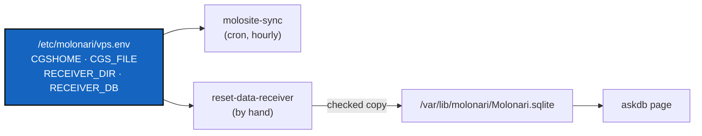

# Changing the `.cgs`, the receiver or its database on the molonari.io server

*Created: 2026-11-11.*

## Abstract — read this first

**The one-line version.** When the Operating Space changes `.cgs`, the server loads the new space next to the old one, then you edit one file, `/etc/molonari/vps.env`, and run `reset-data-receiver`. The website, the plugin, nginx, the credentials and the cron line stay as they are.

**What moves with the `.cgs`.** Four values, all in `/etc/molonari/vps.env`:

- `CGSHOME`, the Operating Space folder: a new `molo load` makes a new `/root/.cgs/MOLONARI-vps-<date>`;
- `CGS_FILE`, the `.cgs` itself;
- `RECEIVER_DIR`, where the receiver repository is mounted (today `Molonaviz`);
- `RECEIVER_DB`, its database, relative to `RECEIVER_DIR` (today `TestDatabase/Molonari.sqlite.backup`).

**What stays.** `/var/lib/molonari/Molonari.sqlite`, the file the `askdb` plugin reads (`SITE_DB`); the plugin itself, nginx and the must-use plugin; the credentials in `/root/.molosite.env` and the `molosite-vps` application password; the cron line and `/usr/local/sbin/molosite-sync`.

`vps.env` is read by the two scripts (template: `server/vps/vps.env.example`). The rest of the server setup is in [OperatingSpaceDeploy.md](OperatingSpaceDeploy.md).

**What `reset-data-receiver` does.** It reads `vps.env`, opens `CGSHOME/RECEIVER_DIR/RECEIVER_DB` read-only, and refuses it unless it has the table the plugin reads (`RawMeasuresTemp` with a `Date` column). It copies it with the SQLite backup API, so a database being written is copied consistently, and checks the copy again (integrity, same rows, same newest date). Only then does the copy replace `SITE_DB`, in one move, so the page never reads a half-copied file. The previous file is kept as `SITE_DB.prev`. `--check` checks the source and writes nothing; any other option is refused.



## 0. Once: install the scripts from git

Skip this if `/etc/molonari/vps.env` exists and `/usr/local/sbin/reset-data-receiver` is installed. On the VPS, as root, before Friday. The values of `vps.env.example` are those of the space loaded on 2026-11-11:

```bash
export PATH="$HOME/.pixi/bin:$PATH"
export CGSHOME=/root/.cgs/MOLONARI-vps-20261111164052
cd $CGSHOME && pixi run --frozen molo update .config/molonari-vps.cgs     # brings server/vps/ from GitHub
G=$CGSHOME/molonari.io/server/vps
install -d -m 755 /etc/molonari
install -m 644 $G/vps.env.example /etc/molonari/vps.env
install -m 700 $G/molosite-sync.sh /usr/local/sbin/molosite-sync
install -m 700 $G/reset-data-receiver.sh /usr/local/sbin/reset-data-receiver
reset-data-receiver --check                     # 72 rows in RawMeasuresTemp, newest 2026-10-21T16:40:32+00:00
/usr/local/sbin/molosite-sync 2>&1 | tail -3    # exit 0
```

## 1. On a laptop: the new `.cgs` and the site map

The server loads `.config/molonari-vps.cgs`, the public part of `.config/molonari.cgs`. When `molonari.cgs` changes, change `molonari-vps.cgs` to match:

- Every repository of `molonari.cgs` that is **not** `private = true` must be in `molonari-vps.cgs`, with the same `relative_path`. The generated pages read each of them, and `pixi run site plan` stops with `<mount>: not a git repository in the Operating Space` when one is missing.
- A private repository never goes into `molonari-vps.cgs`, because the server has no key for it.

If the new space is a different file (for example `.config/molonari-2027.cgs`), make its server version the same way, and change the gate's `website/site.toml`:

- `cgs_file`: the `.cgs` the Operating Space page describes;
- `cgs_variants`: the list of `.cgs` the page names;
- `[roles]`: the keys are mount paths. If the receiver repository moves from `Molonaviz` to another path, rename its key, or the page shows the first paragraph of that repository's README in its place.

Then check, bump, commit and push, as usual for MOLONARI:

```bash
cd molonari.io && pixi run test-all && cd ..       # check: 9 page(s), 0 problem(s)
pixi run bump-version patch                         # in each repository that changed, at the level the release calls for
pixi run cgitsync commit -m "MOLONARI1D-<version>: …"
```

The server cannot see the change until it is on GitHub.

## 2. On the VPS: pause the sync

So that the hourly run does not push from the old space while you switch:

```bash
crontab -l | sed 's|^\(17 .*molosite-sync.*\)$|#\1|' | crontab -
crontab -l | grep molosite-sync        # starts with #
```

## 3. On the VPS: load the new space next to the old one

The same way as on 2026-11-11: a seed clone, used only to run `load`, then deleted. The old space is not touched:

```bash
export PATH="$HOME/.pixi/bin:$PATH"
unset CGSHOME                                       # load must not see the old space
git clone -b CGS-MOLO https://github.com/flipoyo/MOLONARI1D.git /srv/molonari-src
cd /srv/molonari-src && pixi install
pixi run molo load .config/molonari-vps.cgs --https   # or the new server .cgs; prints: export CGSHOME=/root/.cgs/MOLONARI-vps-<date>
cd / && rm -rf /srv/molonari-src
```

Write down the new path. Then test the gate in the new space, without changing anything on the site:

```bash
NEW=/root/.cgs/MOLONARI-vps-<date>                  # the path printed by load
cd $NEW && pixi install
cd $NEW/molonari.io && pixi install && pixi run test-all     # 36 passed; check: 9 page(s), 0 problem(s)
source /root/.molosite.env && CGSHOME=$NEW pixi run site plan  # connected as molosite; nothing in drift
```

`update` lines in that plan are expected: the footers and the versions of the generated pages follow the new space.

## 4. On the VPS: find the receiver and its database

```bash
ls $NEW                                             # where is the receiver repository mounted?
find $NEW -path '*/src/receiver' -type d            # the receiver code
find $NEW -name '*.sqlite*' -not -path '*/.pixi/*'  # candidate databases
```

The receiver's own setting is `src/receiver/settings/config.json`, key `database.filename`, relative to the receiver repository. Today it is `./TestDatabase/Molonari.sqlite`, which git ignores, and the tracked test database next to it is `TestDatabase/Molonari.sqlite.backup`. If the new `.cgs` brings another receiver repository, or another database, its `config.json` says where.

## 5. On the VPS: edit the settings file

```bash
cp /etc/molonari/vps.env /etc/molonari/vps.env.prev
nano /etc/molonari/vps.env
```

Set the four values that move:

```bash
CGSHOME=/root/.cgs/MOLONARI-vps-<date>           # the new space
CGS_FILE=.config/molonari-vps.cgs                # the .cgs it was loaded from
RECEIVER_DIR=Molonaviz                           # the new mount of the receiver repository
RECEIVER_DB=TestDatabase/Molonari.sqlite.backup  # the new database, relative to RECEIVER_DIR
```

Do not change `SITE_DB`: the plugin reads that path.

## 6. On the VPS: put the database in place

```bash
reset-data-receiver --check     # source: …/RECEIVER_DIR/RECEIVER_DB (N rows in RawMeasuresTemp, newest …); nothing written
reset-data-receiver             # done; the previous file is /var/lib/molonari/Molonari.sqlite.prev
curl -s https://molonari.io/askdb/ | grep -o "20[0-9][0-9]-[0-9][0-9]-[0-9][0-9] [0-9:]*" | head -1   # the newest date printed by --check
```

If `--check` refuses the file, the page could not show it. Fix `RECEIVER_DIR` or `RECEIVER_DB`, and run `--check` again. Nothing has changed on the site yet.

## 7. On the VPS: run the sync from the new space, then resume

```bash
/usr/local/sbin/molosite-sync 2>&1 | tail -9      # == <date> <new CGSHOME> …; pushed … (update); exit 0
/usr/local/sbin/molosite-sync 2>&1 | tail -8      # six unchanged; exit 0
crontab -l | sed 's|^#\(17 .*molosite-sync.*\)$|\1|' | crontab -
crontab -l | grep molosite-sync                   # no # at the start
```

## 8. A few days later: remove the old space

After some clean hourly runs (`tail -30 /var/log/molosite-sync.log`), and only if `vps.env` no longer names it:

```bash
OLD=/root/.cgs/MOLONARI-vps-20261111164052
grep -q "$OLD" /etc/molonari/vps.env && echo "still in use: stop" || rm -rf "$OLD"
```

## Going back

Until the old space is removed, going back takes three commands:

```bash
cp /etc/molonari/vps.env.prev /etc/molonari/vps.env
cp -p /var/lib/molonari/Molonari.sqlite.prev /var/lib/molonari/Molonari.sqlite
/usr/local/sbin/molosite-sync 2>&1 | tail -3
```

## If the receiver runs on the server

This is not set up today: the server shows a copy of the test database and no receiver runs. If a live receiver is set up later, keep these points:

- It writes `config.json`'s `database.filename`, relative to its repository. Do not edit `config.json` on the server, because a tracked file changed by hand makes the checkout dirty and blocks `molo update`. Make that path a link to the site database instead: `ln -s /var/lib/molonari/Molonari.sqlite $CGSHOME/$RECEIVER_DIR/TestDatabase/Molonari.sqlite`. The file is ignored by git, so the link dirties nothing. Then set `RECEIVER_DB=TestDatabase/Molonari.sqlite`.
- `reset-data-receiver` then refuses to copy (the source and the target are the same file), which is what should happen: a live database is never overwritten by a copy. To reset it, stop the receiver first, then copy by hand.
- A receiver that runs until stopped needs a service, not cron: a systemd unit that runs `pixi run --frozen run-server` in `$CGSHOME/$RECEIVER_DIR`, restarted on failure.
- The MQTT client certificate and key are in `src/receiver/settings/` (`TLS.crt`, `TLS.key`), tracked in the public repository MOLONARI-API. A private key in a public repository should be replaced, and kept out of git, before a receiver runs in production.
